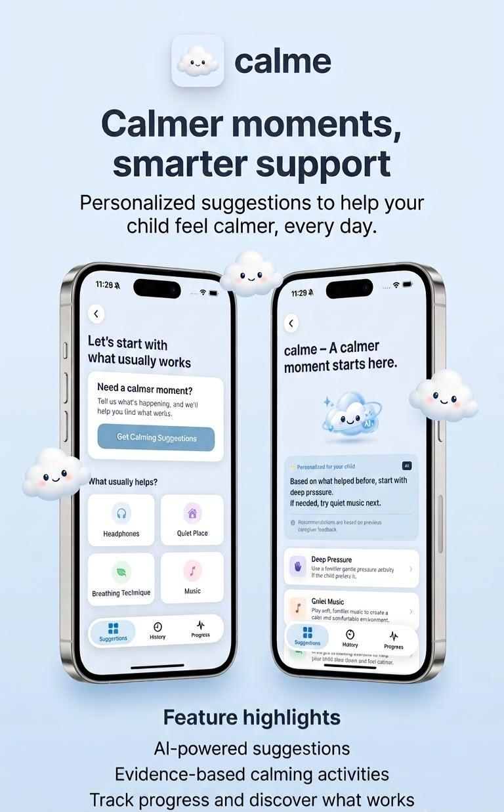
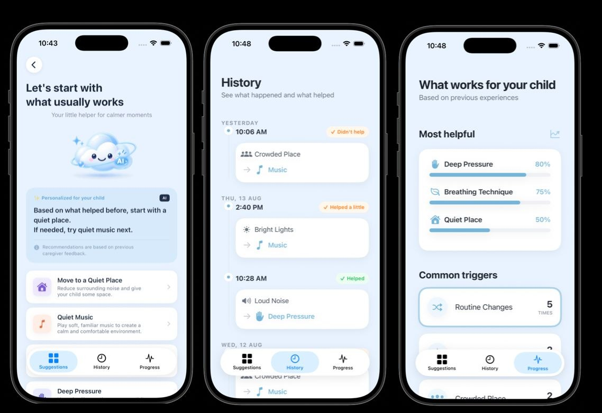

# Calme

### Calmer moments, smarter support.

**AI-inspired personalization · SwiftUI · Human-centered caregiver support**

---

## Product preview

*From left to right: personalized suggestions, history of previous experiences, and progress insights.*

**Human-centered iOS prototype · SwiftUI · AI-inspired recommendation ranking · Accessibility**

Calme explores how a lightweight mobile experience can help caregivers respond to sensory overload situations involving autistic children. Instead of asking users to navigate complex menus during a stressful moment, the app focuses on a short check-in followed by practical, personalized calming suggestions.

## The challenge

Caregivers may need to respond quickly to sensory triggers such as loud sounds, bright lights, crowded environments, or unexpected changes in routine. Finding a suitable response can take time, especially when each child responds differently.

## The approach

1. **Quick check-in:** Record the trigger and intensity.
2. **Relevant suggestions:** Present options such as headphones, a quieter space, breathing activities, or a familiar comfort item.
3. **Feedback loop:** Record whether a suggestion helped.
4. **Personalization:** Use previous caregiver feedback to improve future suggestion ordering.

## AI & personalization

Calme was developed in an AI foundation learning context, with a **feedback-informed recommendation approach** at the center of its product concept. The intended recommendation flow considers:

- **Current context:** The sensory trigger and its reported intensity.
- **Individual history:** Which calming strategies previously helped this child, based on caregiver feedback.
- **Adaptive ordering:** Prioritize suggestions that appear more relevant to the current situation and past responses.

After trying a suggestion, caregivers can record whether it helped. That feedback is intended to inform subsequent recommendations, making the experience more personalized over time.

**Implementation scope:** This is a prototype concept involving recommendation-ranking logic, **not a claim that a trained machine-learning model or clinically validated AI system is deployed**. The repository has not been independently runtime-tested.

## Product principles

- **Caregiver in control:** Suggestions support, rather than replace, human judgment.
- **Low-friction UX:** Prioritize fast interactions and clear language.
- **Accessible design:** Calm visuals and straightforward navigation.
- **Privacy-aware scope:** The concept does not depend on wearable biometric monitoring.
- **No medical claims:** Calme does not diagnose, predict, or treat a medical condition.

## Technologies and disciplines

- **Swift & SwiftUI** — iOS interface development
- **UX/UI design** — streamlined caregiver workflows
- **AI-inspired personalization** — context-aware, feedback-informed recommendation ranking
- **Accessibility** — thoughtful interface design for stressful contexts

## Background

Developed as part of the **Apple Developer Academy | Tuwaiq — AI Foundation Program (2026)**. The concept was informed by consultations with special education specialists and autism care center professionals.

## Repository status

This repository contains an academic prototype export. Some visual assets may be missing, and the app has **not been independently built or runtime-tested** from this repository. References to personalization describe the product concept and prototype logic, not a validated medical AI system.

---

*Designed around a simple principle: meaningful technology should make difficult moments easier to navigate.*
